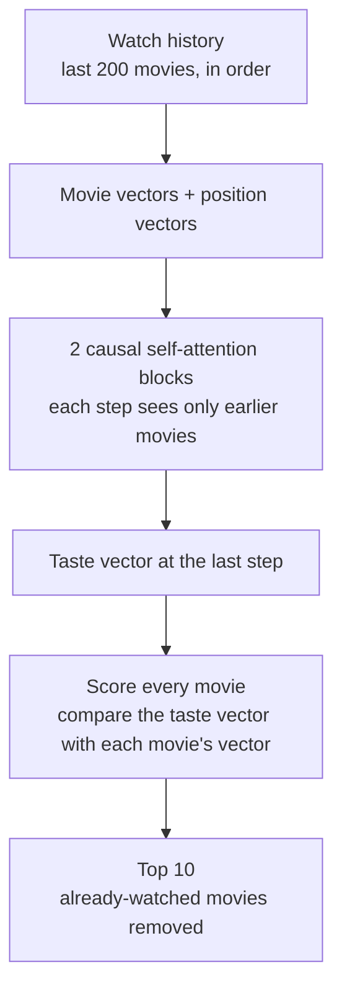

## NextReel- pays attention to what you watch

So NextReel is a SASRec movie recommender that predicts the next movie a user will watch from the order of their watch history. It uses a transformer built from scratch in PyTorch and trains on a laptop CPU.
<hr>

### The idea in plain words

Treat a watch history like a sentence and each movie like a word. GPT reads a sentence and predicts the next word; NextReel reads your watch history and predicts the next movie.

For example, if your last few movies were *Toy Story*, *A Bug's Life* and *Toy Story 2*, a good guess for what comes next is another Pixar film, not a random horror movie.

SASRec (Self-Attentive Sequential Recommendation, Kang & McAuley, 2018) is the model design NextReel follows. It is a small Transformer, the same kind of neural network behind GPT, that works on movie IDs instead of words.

### Why order matters

Many classic recommenders, such as matrix factorisation, treat a history as an unordered pile of movies: watching *Toy Story* then *Toy Story 2* looks the same as the reverse. Real taste moves in runs, like a franchise binge, a horror month or a director phase. A sequence model reads that order; a pile-of-movies model cannot.

The same problem sits behind "Up next", "Because you watched" and home-feed ranking in streaming, shopping, music and food-delivery apps.

### The problem

Given all the movies that user has watched, in order, rank every movie in the catalog by how likely it is to be the next one they watch. 

```math
\hat{s}_{n+1} = \arg\max_{i \in \mathrm{I} \setminus S_u} P\left(i \mid s_1, s_2, \ldots, s_n\right)
```

In the above equation S= s1,s2,...,sn are like the user u's watch history in time order, and the catalog minus already-watched movies in the candidate set.

In plain words: out of all the movies the user has not watched yet, pick the one the model thinks is most likely to come next. In practice NextReel scores every movie and shows the top 10.

### How it works



1. **Input.** Take the user's last 200 movies in order. Shorter histories are padded with zeros.
2. **Movie vectors.** Each movie is turned into a list of 64 learned numbers (an *embedding*), so similar movies end up with similar vectors. A position vector is added so the model knows where each movie sits in the history.
3. **Causal self-attention.** At each step the model looks back at the earlier movies and decides which ones matter most. It can never look ahead, so it can't peek at the answer.
4. **Taste vector.** The output at the last step summarises the user's taste right now.
5. **Scoring.** The taste vector is compared with every movie's vector (a dot product). The same movie vectors are used for the input and for scoring, so the model learns one vector per movie.
6. **Top 10.** Already-watched movies are removed and the 10 highest scores are shown.

**Training.** At every position in a history the target is the next movie, exactly like GPT predicting the next word. So one 200-movie history gives up to 199 practice examples.

### Dataset

NextReel uses [MovieLens 1M](https://grouplens.org/datasets/movielens/1m/): 1,000,209 ratings of about 3,900 movies by 6,040 users.

| File | Format | Used for |
| --- | --- | --- |
| `ratings.dat` | `UserID::MovieID::Rating::Timestamp` | The watch sequences |
| `movies.dat` | `MovieID::Title::Genres` | Movie titles, genres and release years |

Download the zip from GroupLens and unzip it into `data/`. The dataset may not be redistributed, so `data/` is never committed.

**Preprocessing.** Every rating counts as a "watch", whatever the star value. Each user's ratings are sorted by timestamp, and users and movies with fewer than 5 interactions are dropped.

**Split.** Leave-one-out by time: each user's last movie is the test target, the second-to-last is the validation target, and everything before that is used for training.

**Limitation.** MovieLens timestamps record when a user *rated* a movie, not when they watched it, and many users rated dozens in one sitting. So "order" here is partly rating-session order.

The dataset is for research use only. If you use it, cite F. Maxwell Harper and Joseph A. Konstan, "The MovieLens Datasets: History and Context", *ACM TiiS* 5(4), 2015.

### How it's judged

For each of the 6,040 users, the model ranks every movie in the catalog, and we check where the user's real next movie lands.

- **HR@10 (hit rate):** the share of users whose real next movie is in the top 10.
- **NDCG@10:** like HR@10, but a hit at rank 1 counts more than a hit at rank 10.

```math
\text{NDCG@10} = \frac{1}{|U|} \sum_{u \in U} \frac{\mathbb{1}\left[r_u \le 10\right]}{\log_2\left(r_u + 1\right)}
```

Here $r_u$ is the rank of user $u$'s real next movie, and $U$ is the set of users.

**Why rank against every movie.** Many papers rank the real movie against only 100 random ones. That is much easier and gives much higher scores, and Krichene & Rendle showed it can even flip which of two models looks better. NextReel reports full-catalog numbers, and will show the sampled numbers next to them so the gap is visible.

**Baselines.** NextReel only counts as a win if it beats each of these on the same split and metric:

| Baseline | How it ranks | Beating it shows |
| --- | --- | --- |
| Most popular | Most-watched movies overall | Personalisation helps at all |
| Item-to-item | "People who watched A watched B next", from the last movie only | Looking further back than one movie helps |
| Matrix factorisation (BPR) | User vector · movie vector, order ignored | The order of watching matters |
| GRU (optional) | A recurrent network over the same history | Attention beats recurrence here |

**Rules.** Every number is the mean ± std over 3 random seeds. The training epoch is chosen on the validation set only, and the test set is scored once.

### Results

Not available yet. Once training is done, this section will have the comparison table from [results/results.md](results/results.md), the sampled vs full-catalog comparison, and the ablations, such as removing the position vectors to test whether the model really uses order.

### Demo

Coming soon. A Streamlit app will let anyone:

- pick 5 movies they like and get a top 10 straight away, with no retraining;
- compare Most popular, matrix factorisation and NextReel side by side;
- see a "because you watched X" hint from the attention weights;
- shuffle their picks to see the top 10 change, showing that order matters.

### Quick start

Set up a Python 3.11+ environment. The CPU-only PyTorch build is a much smaller download:

```bash
python3 -m venv .venv
source .venv/bin/activate
pip install torch --index-url https://download.pytorch.org/whl/cpu
pip install numpy pandas pyyaml streamlit pytest
```

Download the dataset:

```bash
mkdir -p data
curl -L -o data/ml-1m.zip https://files.grouplens.org/datasets/movielens/ml-1m.zip
unzip data/ml-1m.zip -d data/
```

Commands for training, evaluation and the demo will be added once that code is in.

### Project structure

These files are only skeletons for now.

```
configs/        model and training settings
src/nextreel/   data pipeline, models, training, evaluation and explanations
app/            Streamlit demo
tests/          split and metric tests
results/        results table
```

### Limitations

- **Rating order, not watch order.** The timestamps record when a movie was rated, often dozens in one sitting (see Dataset).
- **Small dataset.** 6,040 users is small for a neural network, so the model can overfit. Dropout and early stopping help.
- **Attention is a hint, not proof.** The "because you watched X" explanation shows where the model looked, not exactly why it chose a movie.
- **IDs only.** The core model knows nothing about plots, posters or cast. Genre and release year may be added as extra features.
- **Old data.** MovieLens 1M users joined in 2000, so their tastes may not match today's.

### References

- Kang & McAuley, [Self-Attentive Sequential Recommendation](https://arxiv.org/abs/1808.09781), ICDM 2018
- Krichene & Rendle, [On Sampled Metrics for Item Recommendation](https://doi.org/10.1145/3394486.3403226), KDD 2020
- Harper & Konstan, [The MovieLens Datasets: History and Context](https://doi.org/10.1145/2827872), ACM TiiS 2015
- [MovieLens 1M dataset](https://grouplens.org/datasets/movielens/1m/), GroupLens
